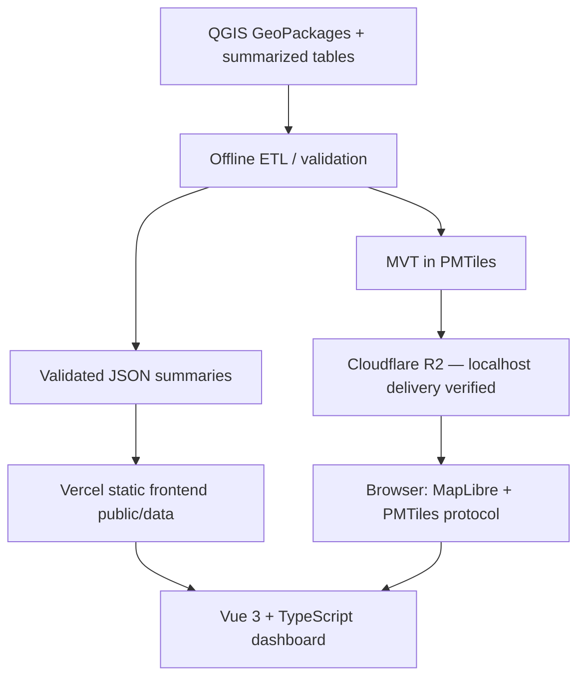

# Architecture — static-first, no PostGIS

## Deployment architecture


## Chosen services
- Frontend: existing Vue 3 + Vite project, intended for Vercel; no deployment authorized yet.
- Browser map: MapLibre GL JS + `pmtiles` protocol.
- Data: precomputed, versioned static JSON; PMTiles blob for building geometries.
- Storage: the repaired archive is uploaded to Cloudflare R2; its public development URL is verified with localhost Range/206, CORS and actual MapLibre interactions. Production custom-domain/origin/cost gates remain. The earlier Blob/SIN1 preference is superseded; decision history is retained in `DECISIONS_AND_RISKS.md`. See `R2_LOCAL_INTEGRATION.md` for measured evidence and the browser/Windows DNS distinction.
- No production Node API endpoints, FastAPI or PostGIS. Development uses a Vite-only fixed-file byte-range middleware; it is not a deployed application backend.
- Keep original GeoPackages offline; no upload of raw research datasets into frontend repo.

## Important technical distinctions
- PMTiles = a ranged HTTP-readable archive. Payload contains vector **MVT**. MBTiles is an SQLite-based tile archive, harder to read directly from object storage without a server or special runtime.
- Static asset distribution does not supply server-side analytics queries. Browser gets global/district/type totals from precomputed summaries, not from visible vector tiles.
- If a filter combination lacks an exact precomputed aggregate, UI must explicitly disable unsupported derived KPIs or require a new aggregate before enabling that filter combination.
- Avoid generating an enormous JSON containing all buildings. The browser requests only necessary tiles based on viewport.

## Implemented application modules (milestone 3)

The existing project and milestone 2 layer are preserved. The app provides one shared dashboard store; the WebGL map loads as a separate asynchronous module. The official `pmtiles` package is the only new application dependency; charts use native HTML/SVG.

```text
src/
  App.vue, main.ts, style.css
  components/
    AppIcon.vue
    dashboard/{KpiCards,CoverageCard,AnalyticalCharts}.vue
    filters/AdminFilters.vue
    map/{SolarMap,MapLoading,BuildingDetails}.vue
    methodology/MethodologyPanel.vue
  map/{protocol,basemap,mapModel}.ts
  composables/useDashboard.ts
  stores/dashboard.ts
  selectors/dashboard.ts
  services/{solarDataService,dataValidation,normalization,boundaryGeoJson,dataError}.ts
  types/{solar,dashboard}.ts
  utils/{format,presentation}.ts
scripts/dev/pmtilesPlugin.ts
tests/map-integration.test.ts
scripts/qa-app.mjs
```

The nine existing `public/data/` files remain unchanged. The active archive is the ignored `data/processed/buildings_eligible_dki_z13-18_repaired.pmtiles`; shared delivery settings live in `src/map/buildingArchive.ts`. The prior archive remains available for rollback. See ARCHIVE_REPAIR_REPORT.md for GeoPackage verification and exact field corrections. No archive enters `public/` or `dist/`.

## Implemented frontend data layer (milestone 2)
The existing publication contract remains unchanged; frontend-specific readonly/filter/scope types live in `src/types/dashboard.ts`. `services/solarDataService.ts` verifies manifest hashes, runtime schemas and compatible releases, with cached summaries and lazy boundaries. `selectors/dashboard.ts` supplies supported KPIs and explicitly scoped marginal charts; administrative × type intersections have no KPI data. `stores/dashboard.ts` uses existing Vue reactivity with per-app ownership, loading/error/retry/refresh state and stale-request protection; `composables/useDashboard.ts` provides injection. Normalization and renderer-owned GeoJSON adapters are now consumed by the map. Milestone 2 required no new dependency; milestone 3 adds the official PMTiles client. See `FRONTEND_DATA_LAYER.md` for the unchanged data APIs and `LOCAL_DEMO.md` for the application.

## Environment variables
```dotenv
# PUBLIC URL: safe in browser, no secret
VITE_BUILDINGS_PMTILES_URL=https://pub-780258dd404b45ddaec3dc7bd19afed1.r2.dev/buildings_eligible_dki_z13-18_repaired.pmtiles
```
**Never** use Blob/R2 tokens, access keys or admin credentials in client environment variables. Keep credentials and large archives out of public assets and Git.

The current ignored `.env.local` activates this development URL. An empty value restores local delivery in development after restarting Vite; preview/production requires a public URL at build time. The URL is configuration only: no source layer, style, attribute or statistical calculation changes. There is no automatic fallback that silently masks remote failures.

## Map source and layer behavior

The active building-tile zoom range is **13–18**. Source attributes in a separate repaired derivative are verified against the original GeoPackage. The historical z14–16 conversion/geometry evidence below is preserved; current repair and delivery evidence is in ARCHIVE_REPAIR_REPORT.md.

- Register PMTiles protocol once before constructing MapLibre map.
- Development defaults to `pmtiles://http://localhost:5173/_local/buildings-z13-18-repaired.pmtiles`; a configured public `VITE_BUILDINGS_PMTILES_URL` takes precedence. The versioned local identity avoids reuse of previous archive entries. The local middleware serves bounded single ranges up to 16 MiB, returns 206/Content-Range, and rejects missing/oversized ranges (416), other archive paths (403) and unsupported methods (405). It exists only in Vite serve mode; preview/production require a verified compatible public URL.
- Actual MBTiles `source-layer` is `buildings_eligible_pvout`; recheck the converted PMTiles, never assume `buildings`.
- Promote `building_uid` for hover/selection across clipped instances. Both building fill and outline apply the proven Polygon predicate plus eligible/admin/type filters; repeated clipped instances are never statistical observations.
- Administrative choropleth appears at low zoom and footprints start at z13, using native archive tiles through z18 with overzoom above that level. Source bounds and all visibility/instruction thresholds use shared delivery settings. Region selection changes choropleth to that region’s districts. NULL annual energy has a separate gray color; no missing generation is converted into zero.
- Style available vs missing PVOUT; keep high-contrast outlines for hover/selection and clear basemap attribution.
- At any zoom MapLibre may render the same polygon clipped across multiple tile boundaries. Aggregation must not use source feature count.
- Empty-state detection uses center-first bounded screen-cell queries and invalidates only when viewport/content/appearance changes. It checks existence, not statistical totals, and avoids materializing every visible building on hover/selection repaints. `maxTileCacheZoomLevels: 2` bounds decoded retention (24 building tiles at the tested desktop viewport). This trades memory for refetching; see TECHNICAL_QA_REPORT.md for measured costs and production budgets.

## QA for local PMTiles and future object storage
1. Confirm file exists, size and format (vector MVT PMTiles).
2. Check PMTiles metadata for zooms, bounds, `vector_layers`/source-layer, property names.
3. HTTP `Range: bytes=0-15` should return `206 Partial Content` and `Content-Range`.
4. Browser fetch from deployed Vercel domain must succeed with correct CORS (test, don't assume).
5. Pan/zoom dense central Jakarta; inspect broken/missing/torn polygons, frame rates, HTTP failures.
6. Verify selected sample `building_uid`, capacity units, and null PVOUT popup against source QGIS.
7. Record actual size, latency, requests and storage cost. R2 production should use a custom domain; r2.dev is a rate-limited development endpoint. Cloudflare documents a 512 MB cacheable-object limit for Free/Pro/Business; do not assume a larger PMTiles archive receives ordinary whole-object CDN caching.

Existing source: `data/raw/buildings_eligible_pvout.mbtiles`, 793,317,376 bytes, 2,659 gzip MVT tiles, z14–16. Official CLI conversion targets ignored `data/processed/buildings_eligible_dki.pmtiles`; run show/verify and compare tile contents. Known type-0 instances require separate diagnostic evidence; conversion is not repair. See `GEOMETRY_QA.md` and `DATA_PIPELINE.md` for schemas, normalization and evidence.

The original z14–16 conversion is complete: 790,567,834 bytes (753.9442386627197 MiB), PMTiles v3; show/verify passed and 28 representative tiles are byte-identical. Isolated Chrome/MapLibre 6.15.0 diagnostics reproduce tile-render failures without a geometry predicate and recover tested rendering/hover/click using an explicit Polygon filter. The predicate now protects both application building layers. Actual-app Chrome QA exercises the official PMTiles browser protocol, real mouse hover/click and dense/island views. Current repaired z13–18 delivery also passes R2 Range/CORS and native-zoom checks through normal Windows DNS; see `R2_LOCAL_INTEGRATION.md`. MapLibre 6’s separate worker is delivered through Vite’s `?worker&url` asset and `setWorkerUrl`. See `LOCAL_DEMO.md` for historical local evidence and limitations.

## Basemap and local behavior

OpenFreeMap Positron and the user-specified Google satellite XYZ endpoint are the two selectable basemaps. Google requests use HTTPS (`https://mt0.google.com/vt/lyrs=s&hl=en&x={x}&y={y}&z={z}`) and a raster layer below research overlays. Switching toggles basemap visibility without replacing the style or resetting filters/selection. Provider attribution stays visible; a failed Google layer falls back to OpenFreeMap, and unavailable OpenFreeMap falls back to a neutral background. The neutral background is not a third menu choice. These are external read-only dependencies; no data is uploaded. See [OpenFreeMap quick start](https://openfreemap.org/quick_start/) and [Google attribution guidance](https://developers.google.com/maps/documentation/tile/policies).

The native MapLibre FullscreenControl targets the whole map panel, retaining controls/legend/details. The opening extent comes from the five mainland administrative MultiPolygons, with padding equal to 10% of the smaller map dimension. The extent control and administrative reset fit the exact combined bounds of all six regions, including Kepulauan Seribu, with symmetric 24 px padding. A hardcoded maxBounds was removed because its aspect constraint clipped north/south DKI during fitBounds. Opening/full-DKI fitted views refit on resize/fullscreen; manually navigated detail views retain their camera. Demo location controls are removed; representative locations live only in the browser QA helper.

Vite watches application sources but excludes raw/processed archives, QA Chrome profiles and local tools; otherwise Windows can crash its watcher on the browser’s locked Cookies file. The server binds localhost on strict port 5173.

## Interface localization

The application provides an isolated reactive Indonesian/English context using the existing Vue APIs. A typed paired catalog drives all components, display names, null-safe number formatting, recovery messages and accessibility labels. The navbar switch persists a valid preference locally and does not affect dataset identity, statistical scope or map filters. Native map labels, DOM markers and attribution update in place, retaining sources, camera, selected features and fullscreen. See [LOCALIZATION.md](LOCALIZATION.md) for contracts and regression coverage.

## Hosting fallback
R2 development delivery is accepted for localhost. Storage remains replaceable through the public URL without rewriting Vue, and the existing local endpoint is available when the environment value is empty. Production custom-domain delivery, production-origin CORS, performance/cost budgets and frontend deployment remain separate gates. No further upload or deployment is authorized in this stage.

References checked during the audit: [PMTiles CLI](https://docs.protomaps.com/pmtiles/cli), [MapLibre integration](https://docs.protomaps.com/pmtiles/maplibre), [storage](https://docs.protomaps.com/pmtiles/cloud-storage), [R2 CORS](https://developers.cloudflare.com/r2/buckets/cors/), [public buckets](https://developers.cloudflare.com/r2/buckets/public-buckets/), [cache limits](https://developers.cloudflare.com/cache/interaction-cloudflare-products/r2/).
