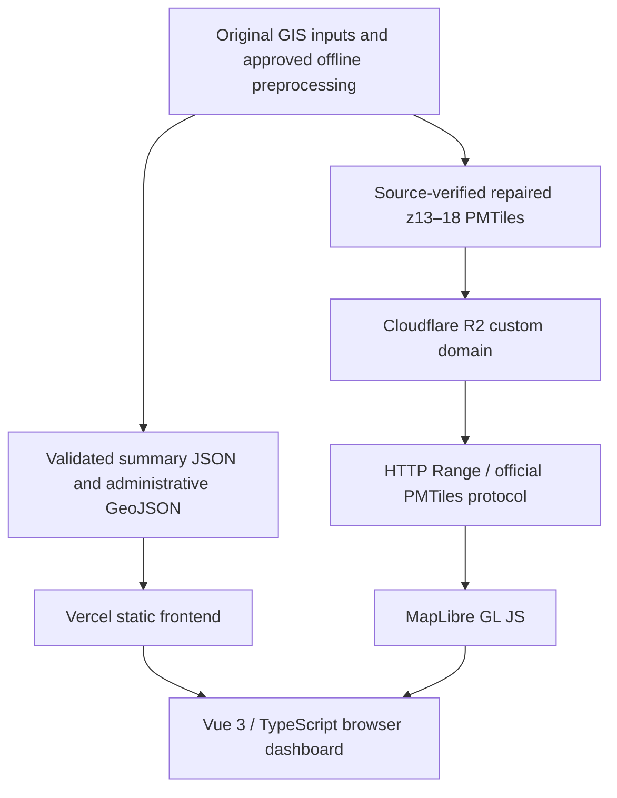

# Architecture — static frontend and range-addressed building data

## Deployment

The owner confirms production deployment on Vercel from `main`. Buildings are served through `tiles.luthfanadli.my.id`; see [deployment](DEPLOYMENT.md) for exact URLs and read-only verification. No application backend, PostGIS or production Node endpoint is used. Historical r2.dev integration evidence remains in [R2 localhost integration](R2_LOCAL_INTEGRATION.md).

## Runtime modules

| Module | Responsibility |
|---|---|
| `src/main.ts`, `App.vue` | App-owned providers, document locale/title and dashboard composition |
| `src/services/` | Manifest/hash/schema verification, release caching, crosswalk normalization and renderer-owned boundary copies |
| `src/selectors/dashboard.ts` | Null-safe, explicitly supported statistical scopes |
| `src/stores/dashboard.ts`, `composables/useDashboard.ts` | Shared reactive resources, loading/error/retry and dependent filters |
| `src/types/solar.ts`, `types/dashboard.ts` | Publication contracts and readonly frontend state |
| `src/i18n/` | Paired typed ID/EN catalog, number/name/error formatting and stored preference |
| `src/components/` | Metrics, filters, charts, map, details, methodology and language controls |
| `src/map/` | Archive constants, official protocol/worker, basemaps, filters/bounds and bounded existence queries |
| `scripts/dev/pmtilesPlugin.ts` | Fixed-file development-only Range delivery |

The WebGL component is loaded asynchronously through `defineAsyncComponent`; it is not an unused static-import omission. Vite emits MapLibre's separate worker from `?worker&url` and `setWorkerUrl`. Dependencies and version selection remain in the existing package/lockfile.

## Data loading and statistics

The nine files in `public/data/` remain an unchanged compatible release. Summary requests are deduplicated/cached per service instance; administrative boundaries load lazily. Response bytes are verified against the manifest, then runtime schemas, totals, crosswalks and compatible metadata are checked. Failed requests can be retried; generation tokens prevent stale refresh responses from overwriting newer resources.

Renderer-owned boundary copies keep MapLibre mutations separate from readonly cached publication data. The store retains filters across refresh only when compatible and clears district selections when their parent changes.

All dashboard totals come from summaries, never rendered/source tile counts. Exact DKI, region, district and DKI-type scopes exist. Administrative area × type and capacity-range aggregates do not. A type predicate may filter buildings while combined metrics remain explicitly unsupported; the type chart stays DKI-wide. Missing PVOUT/annual generation remains null. See [contract](DATA_CONTRACT.md) and [API guide](FRONTEND_DATA_LAYER.md).

## PMTiles and MapLibre

- Delivery settings are centralized in `src/map/buildingArchive.ts`: repaired local file/URL, native zooms **13–18**, source layer `buildings_eligible_pvout`.
- The official `pmtiles` protocol is registered once; `building_uid` is promoted to preserve hover/selection across clipped instances.
- Ordinary fill, highlight fill and outline all share the proven Polygon/eligible/admin/type predicates and visibility.
- The normal fill uses fixed feature-state masking and numeric `fill-layer-opacity`, initially **0.8**, with no opacity transition. A separate highlight fill preserves 0.9 hover/selection emphasis. Slider input does not rewrite feature-dependent expressions or reprocess tiles.
- Raw `useable_m2` adapts to `usable_m2`; omitted NoData energy becomes null. No measurements, geometries or source IDs are recalculated.
- Native tiles through z18 support higher display zoom by overzoom. Known empty type-0 instances are preserved in the archive and excluded by the Polygon predicate. Conversion did not repair geometry.
- Empty-state detection queries center-first bounded screen cells and stops at the first match. Cache retention stays at `maxTileCacheZoomLevels: 2`. These are existing behavior/performance decisions, unchanged by cleanup.

Source verification, full payload preservation, fingerprints and rollback are in [repair report](ARCHIVE_REPAIR_REPORT.md); historical geometry investigation is in [geometry QA](GEOMETRY_QA.md). Never infer population counts from clipped feature instances.

## Basemaps, camera and interactions

OpenFreeMap Positron and the user's HTTPS Google satellite XYZ endpoint are selectable. Switching changes existing layer visibility without recreating sources or clearing selection. Provider attribution is retained. Google failure falls back to OpenFreeMap; external map failure can use a neutral background. These are read-only external dependencies.

Opening extent fits the five mainland cities with 10% padding on the smaller map dimension. Extent/reset fits all six actual administrative geometries, including Kepulauan Seribu, with symmetric 24 px padding. Resize/fullscreen refits the current fitted view; manually navigated views retain their camera. Fullscreen targets the entire map panel. Locale changes update labels/attribution/controls in place without replacing the map. See [design](DESIGN_SYSTEM.md) and [localization](LOCALIZATION.md).

## Configuration and local delivery

`VITE_BUILDINGS_PMTILES_URL` contains a public URL only. Nonempty configuration takes precedence over the local archive; production/preview embeds it at build time. No credentials or access keys are shipped. There is no silent remote-to-local failover.

During Vite serve mode only, an empty variable selects the fixed `/_local/buildings-z13-18-repaired.pmtiles` endpoint. The middleware serves bounded single byte ranges up to 16 MiB with 206/Content-Range. Missing/oversized ranges, other archive paths and unsupported methods are rejected. It never copies archives into `public/` or `dist/`.

The dev server stays on strict localhost port 5173. Watch exclusions protect raw/processed archives, browser profiles and local tools. No Vite, PMTiles, environment or Vercel production configuration was changed during repository cleanup.

## Maintenance and evidence

Use [README](../README.md) for commands and [documentation index](README.md) for script prerequisites/evidence. The dev-only `window.__SOLAR_MAP__` hook supports browser QA and is removed by production compilation; retain it. Dynamic icon names, catalog keys, async components, tested contract exports and historical diagnostic pages must not be removed through naive text matching.

[Technical QA](TECHNICAL_QA_REPORT.md) preserves earlier memory/bandwidth measurements and limitations; deployment is not a new hardware/network or source-rights certification. The latest behavior-preserving maintenance checks are in [repository review](PROJECT_REVIEW.md). Historical byte-identical build claims apply only to their original cleanup snapshot.
