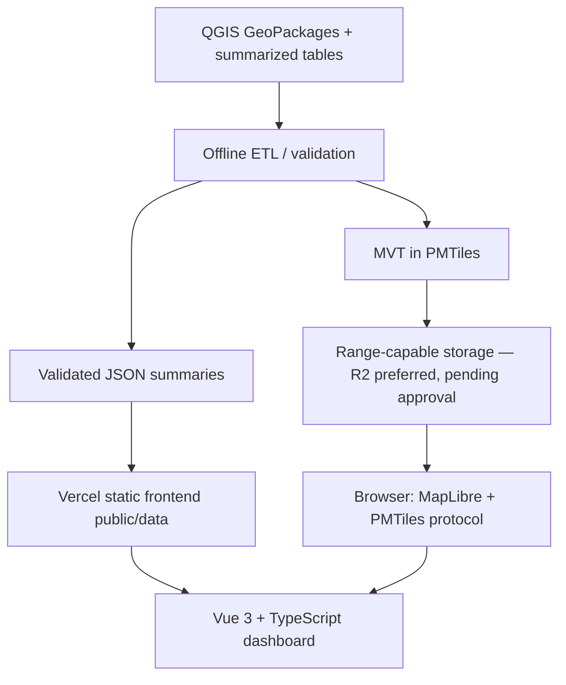

# Architecture — static-first, no PostGIS

## Deployment architecture


## Chosen services
- Frontend: existing Vue 3 + Vite project, intended for Vercel; no deployment authorized yet.
- Browser map: MapLibre GL JS + `pmtiles` protocol.
- Data: precomputed, versioned static JSON; PMTiles blob for building geometries.
- Storage: Cloudflare R2 preferred, not finalized/configured. The earlier Blob/SIN1 preference is superseded by the user's updated requirement; the decision history is retained in `DECISIONS_AND_RISKS.md`. No remote URL or CORS has been verified.
- No Node API endpoints, no FastAPI, no PostGIS for initial read-only release.
- Keep original GeoPackages offline; no upload of raw research datasets into frontend repo.

## Important technical distinctions
- PMTiles = a ranged HTTP-readable archive. Payload contains vector **MVT**. MBTiles is an SQLite-based tile archive, harder to read directly from object storage without a server or special runtime.
- Static asset distribution does not supply server-side analytics queries. Browser gets global/district/type totals from precomputed summaries, not from visible vector tiles.
- If a filter combination lacks an exact precomputed aggregate, UI must explicitly disable unsupported derived KPIs or require a new aggregate before enabling that filter combination.
- Avoid generating an enormous JSON containing all buildings. The browser requests only necessary tiles based on viewport.

## Suggested modules (adapt to existing repository; do not regenerate project)
The tree below is a future application proposal, not the current implementation. Current app: starter App/HelloWorld/main/style and assets; MapLibre installed, PMTiles/UI/state/chart packages absent. Implemented data-only additions: `scripts/`, `tests/`, `data/crosswalks/`, `src/types/solar.ts`, nine generated `public/data/` outputs; ignored `.tools/` and `data/processed/`. Local preprocessing/QA servers are development tools, not a production backend.

```
src/
  components/
    dashboard/KpiCards.vue
    dashboard/RegionComparison.vue
    dashboard/TypeBreakdown.vue
    dashboard/PvoutCoverage.vue
    filters/AdminFilters.vue
    map/SolarMap.vue
    map/MapLegend.vue
    map/BuildingDetails.vue
    methodology/MethodologyPanel.vue
  composables/
    useMapLayers.ts
    useSummaryData.ts
  stores/
    dashboard.ts
  services/
    dataLoader.ts
    mapSources.ts
  types/
    solar.ts
  utils/
    units.ts
    validation.ts
public/
  data/
    summary_wilayah.json
    summary_kecamatan.json
    summary_jenis.json
    summary_pvout_coverage.json
    admin_kabkot.geojson
    admin_kecamatan.geojson    # source exists; normalize with explicit crosswalk
```

Use Pinia, Naive UI, UnoCSS and ECharts when already in the repo or deliberately adopted. Otherwise minimize dependencies. Add a small `src/types/solar.ts` contract first. Use runtime data validation where useful (e.g., Zod only if warranted).

## Environment variables
```dotenv
# PUBLIC URL: safe in browser, no secret
VITE_BUILDINGS_PMTILES_URL=https://YOUR-PUBLIC-STORE-URL/buildings_eligible_dki.pmtiles
```
**Never** use Blob/R2 tokens, access keys or admin credentials in client environment variables. Keep credentials and large archives out of public assets and Git.

## Map source and layer behavior
- Register PMTiles protocol once before constructing MapLibre map.
- Add vector source URL `pmtiles://<verified public URL>`, only in the separately approved integration milestone.
- Actual MBTiles `source-layer` is `buildings_eligible_pvout`; recheck the converted PMTiles, never assume `buildings`.
- Promote feature ID using `building_uid` only if confirmed present/unique/precise in tile attributes.
- Visibility by zoom: admin first, buildings at high zoom (starting experiment z14; exact cutoff performance dependent).
- Style available vs missing PVOUT; keep high-contrast outlines for hover/selection and clear basemap attribution.
- At any zoom MapLibre may render the same polygon clipped across multiple tile boundaries. Aggregation must not use source feature count.

## QA for local PMTiles and future object storage
1. Confirm file exists, size and format (vector MVT PMTiles).
2. Check PMTiles metadata for zooms, bounds, `vector_layers`/source-layer, property names.
3. HTTP `Range: bytes=0-15` should return `206 Partial Content` and `Content-Range`.
4. Browser fetch from deployed Vercel domain must succeed with correct CORS (test, don't assume).
5. Pan/zoom dense central Jakarta; inspect broken/missing/torn polygons, frame rates, HTTP failures.
6. Verify selected sample `building_uid`, capacity units, and null PVOUT popup against source QGIS.
7. Record actual size, latency, requests and storage cost. R2 production should use a custom domain; r2.dev is a rate-limited development endpoint. Cloudflare documents a 512 MB cacheable-object limit for Free/Pro/Business; do not assume a larger PMTiles archive receives ordinary whole-object CDN caching.

Existing source: `data/raw/buildings_eligible_pvout.mbtiles`, 793,317,376 bytes, 2,659 gzip MVT tiles, z14–16. Official CLI conversion targets ignored `data/processed/buildings_eligible_dki.pmtiles`; run show/verify and compare tile contents. Known type-0 instances require separate diagnostic evidence; conversion is not repair. See `GEOMETRY_QA.md` and `DATA_PIPELINE.md` for schemas, normalization and evidence.

Conversion is complete: 790,567,834 bytes (753.9442386627197 MiB), PMTiles v3; show/verify passed and 28 representative tiles are byte-identical. Isolated Chrome/MapLibre 6.15.0 diagnostics reproduce tile-render failures without a geometry predicate and recover tested rendering/hover/click using an explicit Polygon filter. Apply that predicate to all future building rendering layers; it is not yet in the app. The diagnostic serves extracted MVT locally, so PMTiles browser protocol/Range and remote CORS remain untested. MapLibre 6 ships ES modules with a separate worker asset; verify its URL/delivery during Vite integration.

## Hosting fallback
R2 is the preferred candidate, pending measured Range/CORS/performance/cost and explicit publication approval. Storage remains replaceable through the public URL without rewriting Vue. No upload is authorized in the current stage.

References checked during the audit: [PMTiles CLI](https://docs.protomaps.com/pmtiles/cli), [MapLibre integration](https://docs.protomaps.com/pmtiles/maplibre), [storage](https://docs.protomaps.com/pmtiles/cloud-storage), [R2 CORS](https://developers.cloudflare.com/r2/buckets/cors/), [public buckets](https://developers.cloudflare.com/r2/buckets/public-buckets/), [cache limits](https://developers.cloudflare.com/cache/interaction-cloudflare-products/r2/).
